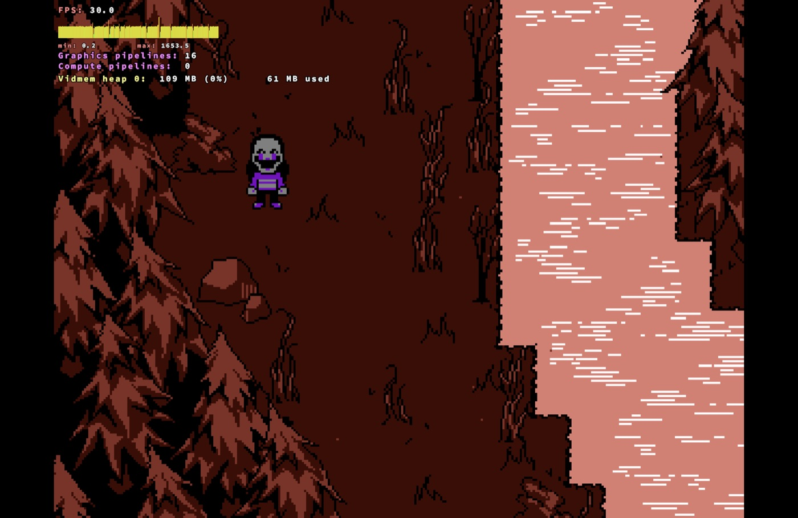

# FNAF: The Flipside — Mac fix (CrossOver / Whisky)

Fixes the **slideshow intro** in **FNAF: The Flipside – Demo 1** on Apple Silicon Macs running **CrossOver** or **Whisky**. Without the fix, the intro drops to about 4 FPS and takes over 5 minutes before you can play. With it, the game runs at a steady **30 FPS**, its designed frame rate. You install it with one double-click.

## The problem

On a Mac, the game starts and plays its intro, but:

- the story text types out at a crawl and the picture freezes for seconds at a time,
- the FPS counter drops to 2–4 FPS while text is on screen,
- getting through the intro takes 5 minutes or more, or it seems stuck.

It isn't your Mac, the graphics, or the game's loading.

## The cause

Two things slow the game down under Rosetta 2, the part of macOS that runs Intel code on Apple Silicon:

1. **A slow CPU instruction.** The game was built with Microsoft's C runtime. On CPUs with SSE4.2, the runtime's text-search functions (`wcsstr` and others) use a special instruction called `PCMPISTRI`. A real Intel or AMD CPU runs it very fast, but Rosetta has no direct equivalent and emulates it slowly. The game searches text constantly while the story types out, so the main thread spent almost all its time in that one instruction.
2. **Memory marked executable.** Several of the game's Clickteam extensions (and CrossOver's own DXVK DLLs) are missing the `NX_COMPAT` flag. When Wine loads such a DLL, it makes **all** of the game's memory executable, and under Rosetta, writing to executable memory is slow.

## The fix

The installer patches **your own copy** of the game. No game files are included or downloaded.

1. In `FLIPSIDE.exe` and the extension files in `Modules`, the C runtime's CPU check is changed so it treats the CPU as SSE2-only. The runtime then uses its plain code paths, which Rosetta translates into fast native code. Nothing else about the game changes.
2. The `NX_COMPAT` flag is set on the extensions that lack it.
3. If a CrossOver bottle uses the **DXVK** graphics backend, the installer offers to switch it to **DXMT**. CrossOver's DXVK DLLs lack the NX flag, so on DXVK the game still freezes.

The original files are kept in `_mac-fix-backup` inside the game folder, and the uninstaller puts them back.

## Install

1. **Quit the game.**
2. Download this project: click the green **Code** button, then **Download ZIP**, and unzip it.
3. Double-click **`Install Flipside Fix.command`**.
4. It finds the game in your CrossOver and Whisky bottles and in Downloads, Desktop, Documents, Applications and Games. When it says **Done**, start the game as usual.

If the game isn't found automatically, the installer asks you to drag the game folder (the one with `FLIPSIDE.exe` in it) into its window.

### "Apple could not verify..." / "unidentified developer"

macOS blocks scripts downloaded from the internet the first time you run them. To allow it:

- **macOS 15 Sequoia and newer:** double-click the file and click **Done** on the warning. Then open **System Settings → Privacy & Security**, scroll down, click **Open Anyway** next to the file name, and confirm.
- **macOS 14 and older:** right-click (or Control-click) the file, choose **Open**, then click **Open** again.

You only need to do this once.

## Graphics backend

| CrossOver graphics setting | Result with the fix |
| --- | --- |
| **DXMT** | Works best, lowest CPU use (recommended) |
| **D3DMetal** (default) | Works. D3DMetal is 64-bit only, so this 32-bit game falls back to Wine's own renderer |
| **DXVK** | Still freezes (CrossOver's DXVK DLLs lack the NX flag). The installer offers to switch it |

You can change it in CrossOver: select the bottle, open its settings, and pick the backend under **Graphics**.

**Whisky:** if the game still freezes, turn **DXVK** off in the bottle's configuration.

## Uninstall

Quit the game and double-click **`Uninstall Flipside Fix.command`**. It restores the original game files, and if the installer switched a bottle to DXMT, it asks whether to switch it back.

## Notes

- Tested with **The Flipside – Demo 1 v1.0.1** on a MacBook Pro M1 Pro, macOS 27, CrossOver 26.3.
- The patcher looks for byte patterns, not fixed addresses, so it should also work on later versions of the demo, and maybe other Clickteam Fusion games with the same slowdown. To patch any folder by hand, run: `perl patcher.pl patch "/path/to/game folder"` (or `check` to only see what it would change, `restore` to undo).
- If you re-download or update the game, run the installer again.
- Running the installer twice is safe: already-patched files are skipped, and the first original is kept.

## How it was found

`sample` and `lldb` can't attach to a game running under Rosetta inside Wine. So [`tools/wine-sampler.c`](tools/wine-sampler.c) is a small sampling profiler that runs **inside** the bottle. It suspends the game's threads ~200 times a second and records where each one is executing. It showed the main thread spending 88% of its time at a single address in `FLIPSIDE.exe`, which turned out to be the `PCMPISTRI` loop in `wcsstr`.

Build it with `i686-w64-mingw32-gcc -O2 -o wine-sampler.exe tools/wine-sampler.c -lwinmm` and run it in the bottle while the game is running: `wine wine-sampler.exe FLIPSIDE.exe 10 5` (10 seconds, every 5 ms).

## Support

If this got the game working for you, you can [buy me a coffee on Ko-fi](https://ko-fi.com/F2J527ZLUN). ☕

Not affiliated with the game's developers, Scott Cawthon, Clickteam, CodeWeavers or Whisky.
